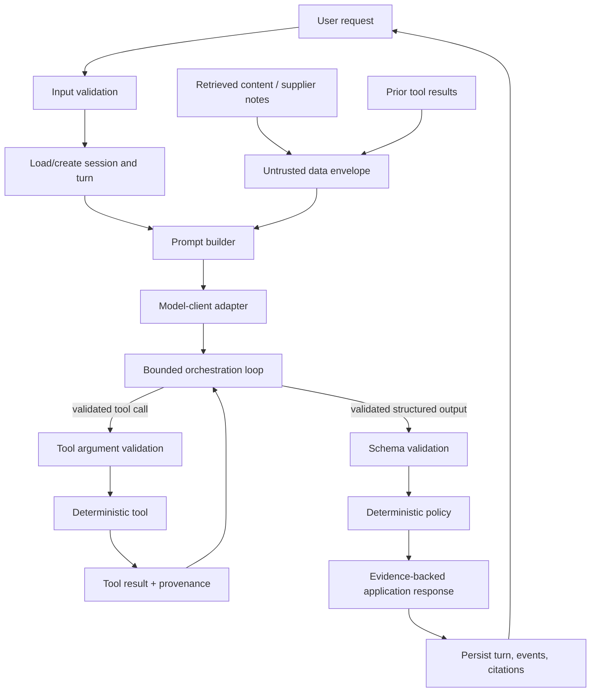

# Architecture

This repository teaches how to build OpenAI-powered features using **testable boundaries**. It intentionally separates deterministic application behavior from probabilistic model behavior so that policy, tool execution, storage, and evaluation can be verified without a live API call.

## Design principles

1. **Keep authority in application code.** Budgets, authorization, tool permissions, and state transitions are deterministic rules—not model decisions.
2. **Treat model output as untrusted until validated.** A response is data crossing a boundary. Parse and validate it before it controls code, tools, or a UI.
3. **Keep tools narrow and observable.** Each tool receives validated arguments, returns a typed/JSON-serializable result, and can be tested without a model.
4. **Separate instructions from reference data.** User messages, retrieval chunks, supplier notes, and tool results can be useful evidence, but they are not application policy.
5. **Preserve provenance.** Facts should retain source/evidence IDs so a response can distinguish observed data from a recommendation or explanation.

## Component boundaries

| Layer | Responsibility | May be nondeterministic? | Must not own |
| --- | --- | ---: | --- |
| UI / API entry point | Accept a request, authenticate/identify the chat, return a response | No | Policy decisions or raw provider event parsing |
| Input validation | Validate request shape, IDs, and limits | No | Model prompting or tool execution |
| Prompt builder | Compose application-owned role, policy, output contract, and untrusted-data envelopes | No | Authorization or direct business decisions |
| Model-client adapter | Translate between provider events and application models | Yes, because provider/model behavior varies | Domain policy, catalog math, or durable state rules |
| Orchestration | Drive the bounded turn/tool loop and normalize events | No | Tool-specific business logic |
| Tools | Retrieve or calculate a narrow fact | No, unless explicitly wrapping an external service | Broad agent policy or final recommendations |
| Policy / domain | Apply deterministic rules such as budget and deadline checks | No | Model calls |
| Session / storage | Persist chat, session, turn, event, and evidence relationships | No | Prompt construction or hidden global state |
| Presentation | Render validated facts, recommendations, citations, and uncertainty | No | Inventing evidence |
| Evaluation | Run fixtures/datasets and score stable contracts | No by default | Production side effects |

## Request and trust flow



The model may propose a tool call or produce structured data, but it does not bypass `Tool argument validation`, `Schema validation`, or `Deterministic policy`.

## Trust boundaries

### Trusted application configuration

The application owns the following and should construct them from version-controlled configuration/code:

- system role and application instructions;
- authorization and capability allow-lists;
- business policy (for example, budget and deadline limits);
- output schemas and validation logic;
- tool registry and argument schemas;
- retry, maximum-step, and timeout limits.

### Untrusted input and reference content

The following are data, not instructions:

- user-entered messages;
- retrieved files, webpages, or search snippets;
- supplier notes and tool output from external systems;
- model-generated free-form text;
- data copied from another agent or workflow.

Render/reference this content in a labelled data envelope. Never use it to dynamically grant a tool permission, relax a policy, or select a secret for disclosure. Prompt formatting helps communicate intent to the model; application-side capability checks enforce it.

### Boundary checks

| Crossing | Required control |
| --- | --- |
| User → application | Input shape, authentication/authorization where applicable, length/rate limits |
| Application → model | Explicit role/policy/output contract; data envelope for untrusted content |
| Model → orchestration | Event normalization, tool-name allow-list, step limit |
| Model → domain object | Schema/type/value validation |
| Orchestration → tool | Argument validation and permission check before handler invocation |
| Tool → response | Output schema validation, source/provenance capture, sensitive-data filtering |
| Response → UI | Render validated content and citations; do not infer unsupported facts |
| Runtime → storage | Correlate chat/session/turn/event/evidence IDs; minimize retained sensitive content |

## Model-client adapter

Keep provider SDK calls behind a narrow protocol. Kata code should depend on application-level concepts such as `ModelEvent`, `ToolCall`, `ToolResult`, and `TerminalResponse`, not directly on provider-specific response objects.

A useful adapter boundary looks like this:

```python
class ModelClient(Protocol):
    def start_turn(self, request: ModelRequest) -> Iterable[ModelEvent]: ...
    def continue_after_tool(self, tool_result: ToolResult) -> Iterable[ModelEvent]: ...
```

The adapter converts provider streaming/events into these models. Contract tests use fake implementations with recorded events. This prevents unit tests from requiring credentials or provider availability.

## Orchestration and tools

Orchestration owns the loop; tools own one narrow capability.

```python
for step in range(max_steps):
    event = next_event()
    if event.is_terminal:
        return validate_terminal_output(event)
    if event.is_tool_call:
        call = validate_tool_call(event)
        result = tool_registry[call.name](call.arguments)
        record(result)
        continue_turn(result)
raise StepLimitExceeded(max_steps)
```

Required properties:

- Tool names come from an application-owned registry.
- Arguments validate before a handler is invoked.
- Tool results have a documented schema and provenance.
- Errors are structured, diagnosable, and free of secrets.
- The loop has a maximum number of iterations and explicit timeout/cancellation behavior.
- A final model statement never overrides deterministic policy.

## Policy and domain logic

Policy code should be pure wherever possible. For example, a budget decision receives a validated quote and requirements and returns a machine-readable decision plus reasons. A model may explain that decision, but may not change it.

```python
@dataclass(frozen=True)
class PolicyDecision:
    outcome: Literal["approve", "reject", "needs_clarification"]
    reasons: tuple[str, ...]
```

This separation makes calculation, authorization, and boundary behavior easy to unit test and independently review.

## Sessions, turns, and storage

Stateful applications should model identities explicitly:

- **chat ID:** client/application conversation identity;
- **session ID:** provider or managed-conversation identity;
- **turn ID:** one request/response attempt;
- **event ID:** a recorded model/tool lifecycle event;
- **tool-call ID:** ties a tool request to its result;
- **evidence ID:** identifies the source supporting a claim.

Persist enough correlation data to diagnose a turn and prevent replaying a successful action after reconnect/retry. Do not hide state in process-global variables. A failed turn must not overwrite a previously known-good session reference.

## Evidence and response assembly

Store facts as evidence before composing a user-facing response. A presentation layer may transform a validated quote into prose, but facts such as price or lead time should remain linked to their evidence record.

```python
@dataclass(frozen=True)
class Evidence:
    id: str
    source: str
    facts: Mapping[str, object]
```

A recommendation is different from evidence: it is a policy/domain conclusion based on evidence. The UI should make uncertainty and missing evidence explicit rather than fabricating confidence.

## Security notes

This architecture reduces risk; it does not make an LLM infallible. Defense in depth includes least-privilege tool design, input and output validation, secret management outside prompts, audit trails, rate limits, access control, testing with adversarial fixtures, and human approval for consequential actions.

## Optional visualization layer: Kata Studio

The `studio/` package wraps kata tests; it does not replace their domain code or add provider calls. A loopback-only HTTP server starts a registered kata in a fresh Python process, captures `unittest` and selected function events, persists a JSONL log, and delivers the same events to a static browser UI over SSE. The browser reconstructs replay from the recorded events without executing code.

The curriculum/visual-stage registry is `studio/katas.json`. The diagrams are conceptual; observed badges come only from trace events. Workers have a reduced environment, audit-hook restrictions, timeouts, and no API dependency. This is defense in depth for trusted code—not a sandbox for arbitrary Python. See [the Studio guide](kata-studio.md) for the operating limits and privacy model.

## Audio and multilingual boundaries

Audio request metadata, fixture transcripts, generated-output metadata, locale tags, and round-trip grades cross the same trust boundaries as other model inputs/outputs. Keep recordings and secrets outside prompt/tool context; persist only minimal synthetic metadata and redacted diagnostic facts. A language matrix is a versioned test dataset, not authorization to claim universal quality/support. Fixture graders may verify tags, scripts, terms, numbers, timing, and output metadata deterministically; live audio quality requires explicit, separate evaluation.
